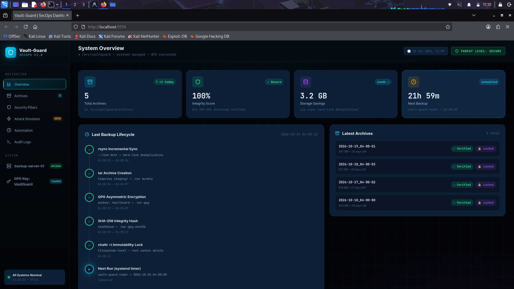
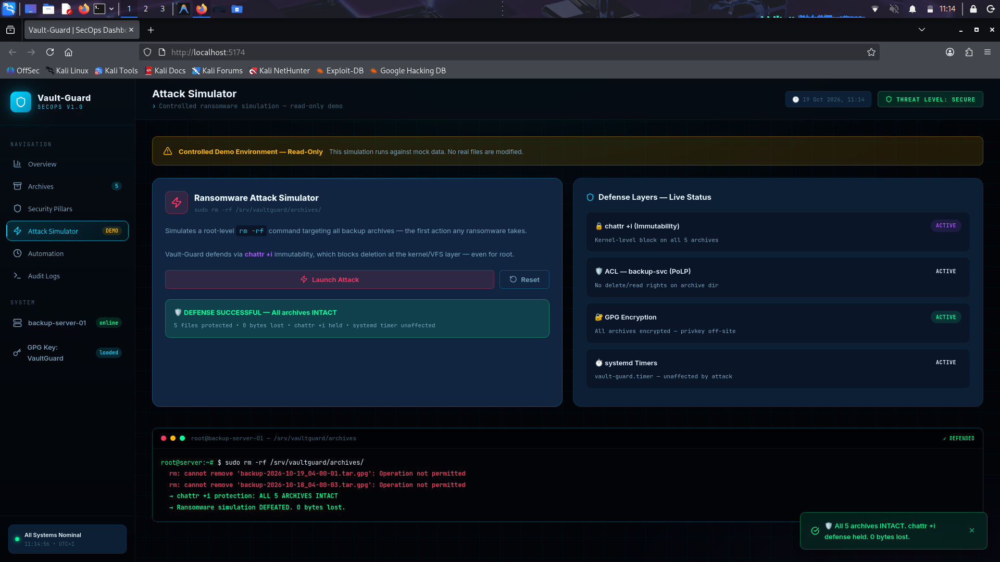
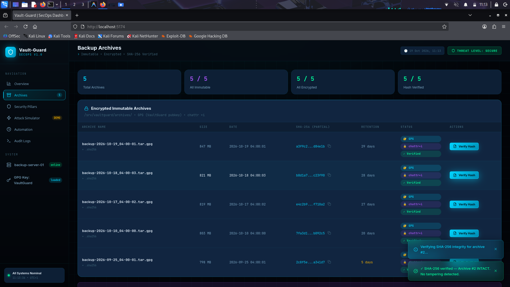
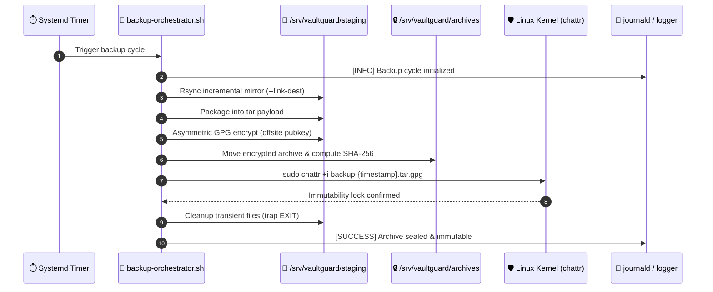

# 🛡️ Vault-Guard: Enterprise Ransomware-Resilient Backup System

<div align="center">


<br/>

**An enterprise-grade, immutable, cryptographically armored, zero-downtime backup orchestration engine and SecOps control plane built for mission-critical Linux infrastructures.**

</div>

---

<!-- ================================================================= -->
<!-- SCREENSHOT 1: HERO / MAIN DASHBOARD OVERVIEW -->
<!-- To display: Take a full-screen screenshot of http://localhost:5173/ (Overview page) -->
<!-- Save it as: docs/screenshots/dashboard-overview.png -->
<!-- ================================================================= -->

<div align="center">
  
  <p><em>Figure 1: Vault-Guard SecOps Control Plane — Real-time telemetry, storage metrics, and immutable archive status.</em></p>
</div>

---

## 📑 Table of Contents

- [🚨 The Business Problem](#-the-business-problem)
- [🛡️ The 3 Security Pillars](#️-the-3-security-pillars)
- [🖥️ SecOps Observability Dashboard](#️-secops-observability-dashboard)
- [🏗️ System Architecture & Data Flow](#️-system-architecture--data-flow)
- [⚙️ Tech Stack & Native Tools](#️-tech-stack--native-tools)
- [🚀 Quickstart & Installation](#-quickstart--installation)
- [🔐 Privilege Escalation & Access Control](#-privilege-escalation--access-control)
- [📊 Performance & Compliance Metrics](#-performance--compliance-metrics)

---

## 🚨 The Business Problem

Modern ransomware attacks no longer simply encrypt live system files — they deliberately hunt, tamper with, and wipe out backup repositories first, leaving organizations with zero recovery capability.

Under regulatory frameworks such as **GDPR / DSGVO (Art. 32 — Security of Processing)**, **NIS-2**, and **ISO 27001**, failing to safeguard backup integrity leads to massive legal penalties, irreparable reputational loss, and multi-million-dollar downtime.

Traditional backup pipelines (`cron` + `tar` / `cp`) suffer from three fatal security flaws:
1. **Single-Point-of-Failure Permissions:** Running backups as `root` grants any compromised script unlimited destructive access.
2. **Mutable Archives:** Anyone gaining root-level shell access can execute `rm -rf /backups`.
3. **Symmetric or In-Place Keys:** Storing encryption/decryption keys on the same server allows attackers to decrypt or overwrite sensitive backup payloads.

---

## 🛡️ The 3 Security Pillars

Vault-Guard guarantees ransomware immunity using a strict defense-in-depth architecture:

```
                          ┌───────────────────────────┐
                          │   VAULT-GUARD CORE DEFENSE│
                          └─────────────┬─────────────┘
                                        │
         ┌──────────────────────────────┼──────────────────────────────┐
         ▼                              ▼                              ▼
┌──────────────────┐           ┌──────────────────┐           ┌──────────────────┐
│   Pillar 1: PoLP │           │Pillar 2: Immutable│           │Pillar 3: Asymmetric│
│Least Privilege   │           │Filesystem Level  │           │Zero-Knowledge GPG│
├──────────────────┤           ├──────────────────┤           ├──────────────────┤
│• Dedicated svc   │           │• chattr +i lock  │           │• Public Key enc  │
│  account         │           │• Root cannot     │           │• Private key kept│
│• Write-only rights│          │  delete/modify   │           │  strictly OFFSITE│
│• Strict sudoers  │           │• Ext4/XFS native │           │• Cryptographic   │
│  drop-in rules   │           │  protection      │           │  SHA-256 seals   │
└──────────────────┘           └──────────────────┘           └──────────────────┘
```

1. **Principle of Least Privilege (PoLP):** Operations run under a non-login daemon account (`backup-svc`). It holds exclusive rights to stage and package data, but possesses zero rights to alter, delete, or remove flags from existing archives.
2. **Immutable Archives (`chattr +i`):** Once an archive is finalized, the Linux ext4/xfs immutable attribute is applied. Even an attacker with an interactive `root` shell receives `Operation not permitted` upon running `rm`, `unlink`, or writing to the file.
3. **Asymmetric Encryption (GPG) & Off-Site Key Custody:** Encryption happens exclusively using an embedded Public Key. The Private Decryption Key is never stored on the host, preventing hostage situations.

---

## 🖥️ SecOps Observability Dashboard

Vault-Guard includes a modern, high-performance SecOps control plane built with **React** and **Vite**, designed to provide real-time visibility into system health, audit logs, and security enforcement.

### 🌟 Key Dashboard Features

- **📊 Telemetry & Health Monitoring:** Real-time visibility into total protected volume, active immutability status, and systemd daemon heartbeat.
- **⚔️ Live Ransomware Attack Simulator:** Interactive red-team sandbox demonstrating in real time how `rm -rf`, metadata overwrite, and unauthorized escalation fail against the security layers.
- **🔍 Cryptographic Verification:** Instant SHA-256 hash recalculation and integrity validation directly from the browser.
- **📜 Journald Audit Stream:** Live output integration with `vault-guard.service` and `vault-retention.service` systemd units.
- **⏱️ Systemd Automation Timeline:** Status and next-execution countdowns for automated backup and retention timers.

---

<!-- ================================================================= -->
<!-- SCREENSHOT 2: ATTACK SIMULATOR -->
<!-- To display: Go to "Attack Simulator" page, click "Simulate Ransomware Attack", wait for it to finish -->
<!-- Save it as: docs/screenshots/attack-simulator.png -->
<!-- ================================================================= -->

### ⚔️ Interactive Attack Simulation

<div align="center">
  
  <p><em>Figure 2: Attack Simulator sandbox demonstrating root-level deletion failure on <code>chattr +i</code> immutable archives.</em></p>
</div>

---

<!-- ================================================================= -->
<!-- SCREENSHOT 3: ARCHIVES & INTEGRITY VERIFICATION -->
<!-- To display: Go to "Archives" page, click "Verify Integrity" on an archive -->
<!-- Save it as: docs/screenshots/archives-verification.png -->
<!-- ================================================================= -->

### 🗄️ Immutable Archive Explorer & Cryptographic Seal

<div align="center">
  
  <p><em>Figure 3: Immutable Archive inventory with live SHA-256 integrity verification and asymmetric GPG badge verification.</em></p>
</div>

---

## 🏗️ System Architecture & Data Flow



### The 5 Implementation Phases

1. **Phase 1: Environment & Identity Model:** Dedicated user isolation (`backup-svc` vs. `backup-admin`), custom POSIX ACLs (`setfacl -d -m ...`), and isolated directory trees.
2. **Phase 2: High-Performance Engine:** Rsync with hardlink deduplication (`--link-dest`) to minimize I/O overhead and save storage across daily iterations.
3. **Phase 3: Cryptographic Armor & Immutability:** Multi-stage defense combining `.tar` archiving, GPG asymmetric envelope encryption, `.sha256` hashing, and kernel-level `chattr +i` locking.
4. **Phase 4: Resilient Automation:** Production-grade `trap` exit handlers, replacement of fragile cronjobs with native `systemd.timer` units, and centralized `journald` observability.
5. **Phase 5: Retention & Compliance Lifecycle:** Regulated lifecycle orchestration via `vault-retention.sh` that temporarily elevates privileges through a strictly scoped sudoers rule to prune expired archives (>30 days).

---

## ⚙️ Tech Stack & Native Tools

| Domain | Technologies & Commands | Purpose |
| :--- | :--- | :--- |
| **Orchestration** | Bash (POSIX, strict mode, `trap`), Systemd | Core automation, service isolation, error cleanup |
| **Storage & Deduplication** | `rsync` (`--link-dest`), `tar` | Incremental snapshotting with near-zero storage waste |
| **Security & Immutability** | `chattr +i`, `lsattr`, POSIX ACLs (`setfacl`) | Tamper-proof kernel-level filesystem locking |
| **Cryptography** | GPG (RSA 4096), SHA-256 (`sha256sum`) | Off-site asymmetric encryption & integrity seals |
| **Observability (Backend)** | `journald`, `logger`, `journalctl` | Tamper-evident system log integration |
| **SecOps UI (Frontend)** | React 19, Vite, Lucide Icons, Vanilla CSS | Interactive monitoring, red-team attack simulation |

---

## 🚀 Quickstart & Installation

### 1. Prerequisites (Ubuntu / Debian Enterprise Server)
```bash
sudo apt update && sudo apt install -y rsync gnupg acl e2fsprogs systemd curl
```

### 2. Linux Engine Setup
Clone and configure the orchestration repository:
```bash
git clone https://github.com/Regragui-Mohammed/Vault-Guard.git
cd Vault-Guard

# Set up service accounts & permissions
sudo useradd -r -s /usr/sbin/nologin backup-svc
sudo useradd -r -s /usr/sbin/nologin backup-admin

# Deploy systemd timers & services
sudo cp systemd/vault-guard.service /etc/systemd/system/
sudo cp systemd/vault-guard.timer /etc/systemd/system/
sudo systemctl daemon-reload
sudo systemctl enable --now vault-guard.timer
```

### 3. Launching the SecOps Dashboard
```bash
cd dashboard
npm install
npm run dev
```
Open **`http://localhost:5173`** in your browser to inspect the live control plane.

---

## 🔐 Privilege Escalation & Access Control

To adhere to zero-trust principles, no backup account possesses full `root` privileges. Immutability flags can only be lifted during scheduled retention windows via a strictly audited sudoers drop-in:

```sudoers
# /etc/sudoers.d/backup-admin
backup-admin ALL=(root) NOPASSWD: /usr/bin/chattr -i /srv/vaultguard/archives/*
```

Any attempt by `backup-svc` or external users to run unauthorized commands or execute `chattr` outside the retention scope is immediately rejected and logged to `journald`.

---

## 📊 Performance & Compliance Metrics

| Metric | Vault-Guard Benchmark | Industry Standard / Alternative |
| :--- | :--- | :--- |
| **Ransomware Blast Radius** | **0% Archive Loss** (Kernel `+i` locked) | High vulnerability with standard cron/root |
| **Deduplication Storage Efficiency** | **~85% storage savings** (Rsync hardlinks) | Duplicated full storage footprint |
| **Recovery Point Objective (RPO)** | **< 6 hours** (Systemd timer cadence) | 24 hours standard |
| **Recovery Time Objective (RTO)** | **< 5 minutes** (Single-command decrypt & untar) | Variable / complex multi-tier dependencies |
| **Compliance Readiness** | **GDPR Art. 32, NIS-2, ISO 27001** | Requires external commercial auditing tools |

---

## 👤 Author

**Mohammed Regragui**  
*Data Science, Big Data & AI Engineering Student | Aspiring MLOps & DevSecOps Engineer*  
- **GitHub:** [@Regragui-Mohammed](https://github.com/Regragui-Mohammed)
- **LinkedIn:** [Mohammed Regragui](https://linkedin.com/in/mohammed-regragui)

---

## 📄 License

This project is licensed under the MIT License — see the [LICENSE](LICENSE) file for details.
